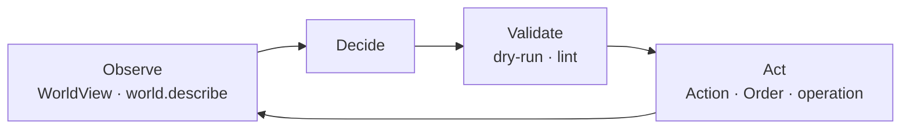

# Agent hub

ZARVAN is designed so an agent can inspect a world, propose a change, validate
it, and observe the result without reaching around the simulation's rules.
This page is the shortest route into the agent-facing surface.

## Choose an integration

<div class="zv-agent-grid" markdown>

<div class="zv-agent-card" markdown>

### Runtime behavior

Give an entity a read-only `WorldView` and return an `Action`. The engine owns
mutation, collision, timing, and validation.

[:octicons-arrow-right-24: Agent API](concepts/agent-api.md)

</div>

<div class="zv-agent-card" markdown>

### Turn-based player

Read a JSON snapshot, choose an `Order`, and submit it. Fog of war and the
turn system keep the agent's view and authority explicit.

[:octicons-arrow-right-24: Agent-driven tutorial](tutorials/03-agent-driven-game.md)

</div>

<div class="zv-agent-card" markdown>

### Authoring operator

Use the same operation names through MCP, REST, JSON-RPC, or the `zarvan`
CLI to create, edit, validate, and undo content.

[:octicons-arrow-right-24: Operations](reference/operations.md)

</div>

</div>

## The canonical loop



```dart
final view = world.viewFor(agentEntity);
final proposal = behavior.decide(view);

// The engine validates and applies the proposal at the correct simulation
// phase. The behavior never receives a mutable component store.
world.actions.enqueue(agentEntity, proposal);
```

!!! tip "Read before writing"
    Start with `world.describe` or `World.toJson()`, validate patches with
    `dryRun: true`, and use `--read-only` whenever the task is observational.

## Machine-readable resources

| Resource | Purpose |
|---|---|
| [`/llms.txt`](../llms.txt) | Compact index of every documentation page |
| [Operations](reference/operations.md) | One registry shared by CLI, MCP, REST, and JSON-RPC |
| [Components](reference/components.md) | Exact JSON shape of registered components |
| [Events](reference/events.md) | Simulation events and ordering |
| [Transports](reference/transports.md) | Connection and authentication quick start |

The generated API docs live under [`/api/`](../api/). For source-level truth,
inspect the public symbols in `packages/*/lib/src/`.

## Agent checklist

- Keep simulation code deterministic: fixed timestep, `world.random`, no wall-clock reads.
- Propose changes through `Action`, `Order`, a checked patch, or an operation.
- Validate content before running it: `zarvan lint` and `project.problems`.
- Expect unregistered components to be absent from serialization.
- Restrict permissions with `--read-only`, `--allow`, and `--deny`.

!!! note "For humans building agents"
    The [AI-agent guide](guides/for-ai-agents.md) explains the same contract
    in a linear format; this page is the map and the quick reference.
