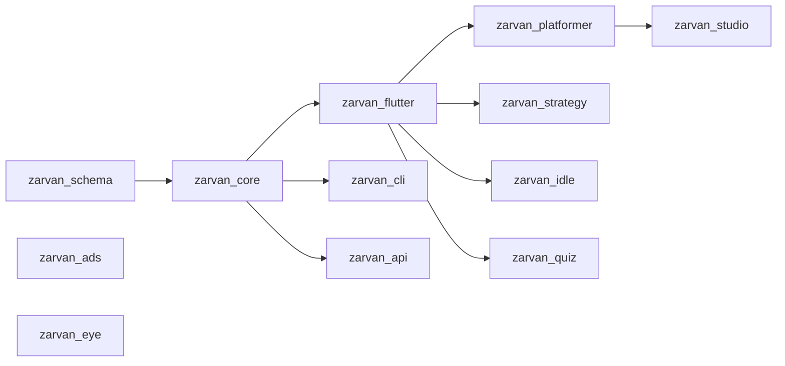

# Packages

ZARVAN is a set of small Dart/Flutter packages on a **directed acyclic dependency graph**: packages may depend only on upstream packages. The diagram shows primary paths, not every direct manifest edge.

| Package | Audience | What it gives you | Runtime |
|---|---|---|---|
| [`zarvan_core`](packages/zarvan_core.md) | Developers, agents | The engine: ECS, physics primitives, `TileMap`, content DSL, the `WorldView`/`Behavior` agent API, the turn-based rules (turn clock, orders, navigation, combat, fog of war), idle-game rules, and the operation registry. | Pure Dart, no Flutter |
| [`zarvan_schema`](packages/zarvan_schema.md) | Tool builders, agents | Hand-written component schemas used by the CLI and Studio to validate content. | Pure Dart |
| [`zarvan_flutter`](packages/zarvan_flutter.md) | Developers | The Flutter shell: `Game`/`Scene`, sprites, camera, lighting, input, audio, save/load. No gameplay logic. | Flutter |
| [`zarvan_platformer`](packages/zarvan_platformer.md) | Developers | Gravity, jump, tile/platform collision, combat, patrol/follow AI, animation. | Flutter |
| [`zarvan_strategy`](packages/zarvan_strategy.md) | Developers | One-call wiring for turn-based strategy and unit spawning. | Flutter |
| [`zarvan_idle`](packages/zarvan_idle.md) | Developers, game makers | Idle/incremental games: widgets, controller, session, saving. | Flutter |
| [`zarvan_api`](packages/zarvan_api.md) | Agents, operators | MCP server and HTTP / JSON-RPC API over the operation registry. | Pure Dart |
| [`zarvan_eye`](packages/zarvan_eye.md) | Game makers | Dart client for Eye analytics: launch sessions, installation identity, offline queues, lifecycle/game helpers, metadata and error reporting. | Pure Dart |
| [`zarvan_quiz`](packages/zarvan_quiz.md) | Developers, game makers | Quiz / fill-in-the-blank games: session, progress, race clock and card/options/HUD widgets. Rules live in `zarvan_core`. | Flutter |
| [`zarvan_ads`](packages/zarvan_ads.md) | Game makers | Banner, interstitial and rewarded ads behind one `AdService`, with consent and pacing. | Flutter |
| [`zarvan_cli`](packages/zarvan_cli.md) | Game makers, agents | The `zarvan` command: `create`, `upgrade`, `lint`, and every operation as a command. | Pure Dart |
| [`zarvan_studio`](packages/zarvan_studio.md) | Game makers | The visual Studio for editing levels and content. | Flutter |

Every package has its own page: click its name in the table.

## Which one do I need?

| I am building… | Depend on |
|---|---|
| A headless simulation or test harness | `zarvan_core` |
| A platformer | `zarvan_platformer` (brings core and flutter) |
| A turn-based strategy game | `zarvan_strategy` |
| An idle game | `zarvan_idle` |
| A quiz game | `zarvan_quiz` |
| Ads or analytics in a shipped game | `zarvan_ads`, `zarvan_eye` |
| A tool or agent that drives worlds | `zarvan_api` or the `zarvan` CLI |

Not published to pub.dev yet (pre-1.0): generated projects depend on the
packages through a self-referencing git dependency. See
[Getting started](getting-started.md#why-a-git-dependency).
